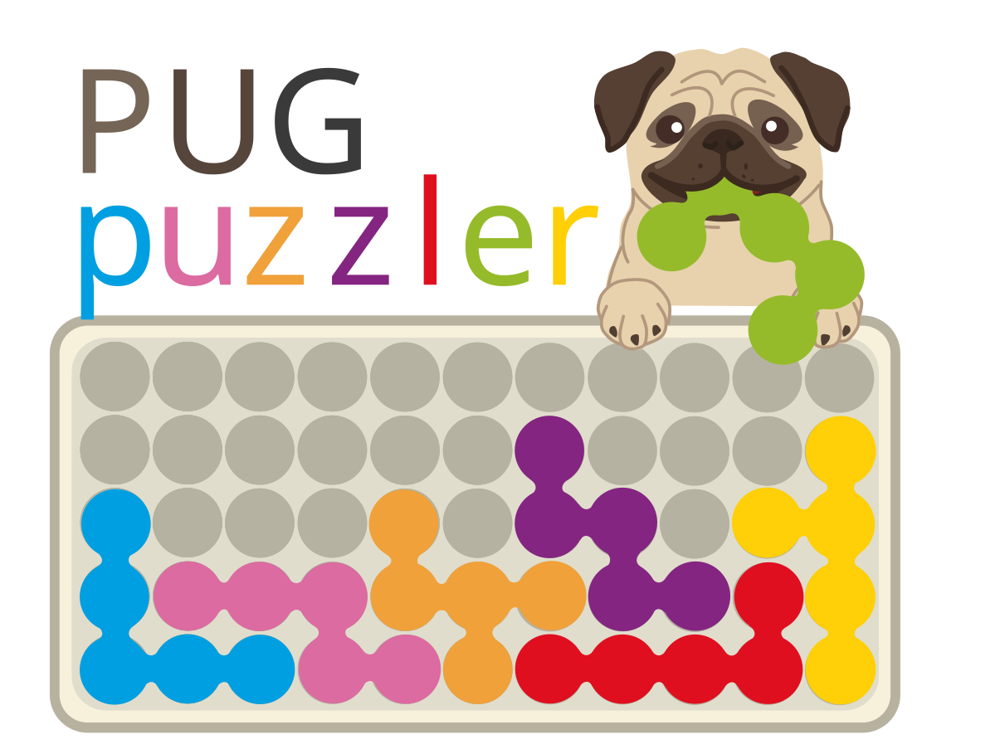

<p align="center">
  
</p>

# PUGpuzzler

*Packing Under Geometry*

**PUGpuzzler** is a solver for polyform-based packing puzzles: given a board and a set of pieces, it finds **every** way to fill the board. It frames the puzzle as an exact cover problem, using Knuth's Algorithm X with bitmasks instead of dancing links, compiled with numba.

It started as a project to investigate the difficulty of such games, but grew into a more general tool along the way. PUGpuzzler supports:

- 2-dimensional and 3 dimensional puzzles
- puzzles on rectangular and offset (pyramid) lattices
- easy loading and saving of new puzzles
- tools for investigating the puzzles and their solutions 


## Why

As a kid I would often spend hours at a time trying to solve the puzzles from the **IQpuzzler** from SmartGames. 

A few years ago, I started wondering whether the prescribed puzzles from the booklet were actually as difficult it could get. To answer this, I tried to write a solver for this game in Python. It worked, but it was too slow and I did not manage to make it fast enough with the limited knowledge I had then. Since it was not able to answer my question, I abandoned it. 

Recently, I picked it up again and rewrote it from scratch, this time generalizing it to 3D puzzles and other variants. Along the way, I gained some other interesting insights, which I thought were worth sharing as a fun read.

## What it found

The tutorials run the solver on the puzzle booklets of **IQpuzzler** (the original) and **IQpuzzlerPRO** (the sequel, with a flat board, a diagonal one and a 3D pyramid), and ask what the puzzles themselves look like:

1. **How many solutions do the puzzles have?** This depends on the game; the number of solutions to a puzzle of IQpuzzler ranges between 1 and over a thousand. On the other hand, the IQpuzzlerPRO promises a unique solution to each puzzle, and this is nearly true: all but one of its 120 puzzles are unique. Pyramid puzzle 120 has five.
2. **How is the difficulty of the puzzles determined?** By how many cells are given, not by how many solutions there are: the tiers follow the filled cells, and the number of solutions does not seem to correlate to the difficulty (for IQpuzzler).
3. **Do there exist puzzles harder than those in the booklets?** Yes: for example, the IQpuzzler board can force a unique solution using just two pieces (7 cells), while the booklet never gives fewer than three (13 cells).


## Tutorials


The best way to see how it all works is to run the two notebooks in [tutorial/](tutorial/). Everything in them is computed when you run it.

1. [1_solver.ipynb](tutorial/1_solver.ipynb): the algorithm: how a game is represented and how the search works, followed by an exemplary solve with a puzzle small enough to follow node by node. 
2. [2_findings.ipynb](tutorial/2_findings.ipynb): the applications: the questions above, answered on the real puzzle booklets.

For the code itself, [SOLVER_WALKTHROUGH.md](docs/SOLVER_WALKTHROUGH.md) goes through the solver, and [SOLVER_NOTES.md](docs/SOLVER_NOTES.md) has the measurements behind each design choice, including the ideas I tried and removed.

## Quick start

```
pip install -e .
python run_tests.py
```

Install it editable (`-e`): the package reads `games/` from this checkout.

Solve a booklet puzzle and print its solutions:

```python
from pugpuzzler.constants import GAMES_DIR
from pugpuzzler.serialization import load_game
from pugpuzzler.solving import solve_puzzle, Verbosity

game = load_game(GAMES_DIR / "IQpuzzler")
solutions, stats = solve_puzzle(game.books["main_puzzles"]["50"], verbose=Verbosity.SHOW_SOLUTIONS)
```

A game lives in `games/<Game>/`: `blocks.json`, `boards.json`, and optional `books/` and `puzzles/` folders. `CLAUDE.md` has a full map of the codebase.

## On agentic coding, and the name

With the help of agentic coding, this task turned out to be far less daunting than it looked. As the project went on, I leaned more and more on LLMs for advice on architecture, cleaning up code and running tests. But unlike with my first attempt years ago, I could feel that I didn't have a full grasp of what the code was doing. I understood the individual parts, but the full picture was slipping away from me. Near the end of the project, I came across [this video](https://youtu.be/0Ge3jKLDJaA) from 3Blue1Brown creator Grant Sanderson:


It resonated with me. Before this project, I felt I had a deeper understanding of the code I produced, and now I found myself placing more trust in these agentic models. I was starting to identify more with the pug than the border collie. Hence the name: PUGpuzzler (Packing Under Geometry being the respectable reading).

To be clear, I still claim responsibility for this project and what it does. I have a good understanding of the code, although maybe not as deep as I could. But that was never the goal: I started this out of curiosity and passion, to answer some questions about a game I hold dear, and I think PUGpuzzler succeeded at that.

This is a personal project, not a polished tool, and it isn't unique either. Many similar solvers exist, probably more efficient and more general (see [polyformpuzzler](https://puzzler.sourceforge.net/), [cemulate's polyomino-solver](https://github.com/cemulate/polyomino-solver), and others).

## License

MIT, see [LICENSE](LICENSE).
